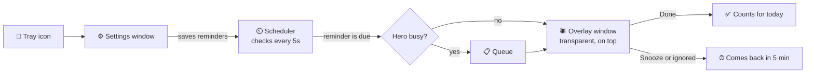

<div align="center">

<br>

# 🕸️ S W I N G B Y

### *Your reminders, delivered by a very polite menace.*

<br>


<br>

<!-- Put a GIF of the hero swinging in here. It is the best thing on this page. -->


<br>

</div>

---

## 💬 The problem

Normal reminders are a small box in the corner of your screen. You swipe it away without reading it, and three hours later you realise you haven't had water since breakfast.

**SwingBy fixes that with drama.**

A hero swings in on a web line, types out a short message, and waits for your answer. He shows up over **any app**: Word, your desktop, a browser, a game. He never steals your keyboard, so your typing is safe.

---

## ⚡ What it can do

| | |
|---|---|
| 🕷️ **Shows over everything** | Appears on top of any app without taking your typing focus. |
| ⏰ **Two kinds of reminders** | Repeat every X minutes, or ring at exact times like `7:00 PM` and `2:00 AM`. |
| ⏱️ **Quick timer** | "Remind me in 10 minutes about the tea." |
| 💬 **Texting-style bubble** | Typing dots first, then the message types out letter by letter. |
| 😴 **Snooze or done** | Snooze brings him back in 5 minutes. Ignore him and he swings away, then returns. |
| 🌙 **Quiet hours** | Repeating reminders pause at night. Clock alarms still ring, because you set those on purpose. |
| 🔔 **Lives in your tray** | Close the window and he keeps watching. Pause, test or quit from the tray menu. |
| 🚀 **Starts with your PC** | Tick one box and he is on duty every time you sign in. |
| 🎨 **Dark by design** | Every reminder has an editable name, message and schedule. |

> The hero is an **original character**, drawn in SVG and animated in CSS. No trademarks were harmed.

---

## 🎬 A day with SwingBy

```text
 10:00   💧  "Water break. You've been at it a while."
 10:30   💧  "Water break. Still at it?"
 11:00   🤸  "Stretch. Stand up. Roll your shoulders."
 19:00   ⏰  Your 7 PM alarm. Rings no matter what.
 23:00   🌙  "Wind down. Save your work."
 02:00   ⏰  Yes, he will wake you up at 2 AM if you ask him to.
```

---

## 📥 Get it

### Just want the app? (Windows)

1. Open the [**Releases**](https://github.com/Nishupathak/swingby-desktop/releases) page.
2. Download **`SwingBy Setup 1.0.0.exe`** and double-click it.
3. If Windows says *"Windows protected your PC"*, click **More info**, then **Run anyway**.
   That screen shows up for any app without a paid signing certificate.
4. Open **SwingBy** from the Start menu and tick **Start SwingBy when I sign in**.

### Want to run the code?

```bash
git clone https://github.com/Nishupathak/swingby-desktop.git
cd swingby-desktop
npm install
npm start
```

Build your own installer with `npm run dist`. It appears in the `dist` folder.

---

## 🧠 How it works



**Two windows, one app:**

- **The overlay** is a transparent, frameless, always-on-top window that appears without taking focus. Clicks pass through to the app underneath, except when your mouse is over the speech bubble.
- **The settings window** is where you manage reminders. Closing it hides it in the tray instead of quitting.

```text
swingby-desktop/
├── main.js        🧠 scheduler, tray, windows, saved data
├── preload.js     🔒 safe bridge between windows and the main process
├── defaults.js    💬 starting reminders and their wording
├── overlay/       🕷️ the hero, the bubble, the typing effect, the thwip
├── settings/      ⚙️ the dark settings window
└── assets/        🎨 icons
```

---

## 🛠️ Problems I had to solve

<details>
<summary><b>How do you draw over Word without stealing the keyboard?</b></summary>

The overlay is a non-focusable window shown with `showInactive()`, so your typing never moves. Click-through is switched on everywhere except the speech bubble, so you can still press Done and Snooze.
</details>

<details>
<summary><b>How do you ring at exactly 2:00 AM?</b></summary>

Clock alarms are checked against local time with a short grace window. A brief sleep or a slow start does not skip an alarm, and a one-per-day record stops the same alarm ringing twice.
</details>

<details>
<summary><b>What should quiet hours silence?</b></summary>

Only the repeating reminders. If you set an alarm for 2 AM yourself, you meant it, so it still rings.
</details>

<details>
<summary><b>What if two reminders fire together?</b></summary>

They queue up. The hero finishes the first one, leaves, and then comes back for the next.
</details>

---

## 🎨 Make it yours

| Want to change... | Edit this |
|---|---|
| What the hero says | `defaults.js` or the settings window |
| Snooze length | `SNOOZE_MIN` in `main.js` |
| The bubble and colours | `overlay/overlay.css` |
| The hero's look | the SVG in `overlay/overlay.html` |
| Typing speed and the thwip | `overlay/overlay.js` |

---

## 🗺️ What's next

- [ ] A different entrance for each reminder type
- [ ] Streaks and a weekly summary
- [ ] Pomodoro mode
- [ ] A Mac build


